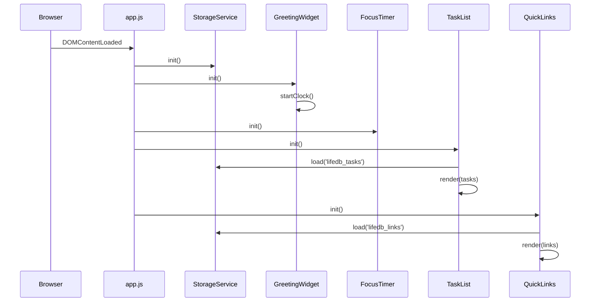

# Design Document

## Overview

The To-Do Life Dashboard is a single-page, fully client-side web application built with plain HTML, CSS, and vanilla JavaScript. It requires no build step, no backend, and no external dependencies — the user opens `index.html` directly in a browser and everything works offline.

The application is structured as four independent widgets that share a common persistence layer (the browser's `localStorage` API). Each widget owns its own rendering and business logic; they communicate only through the shared storage interface. This keeps the codebase flat, readable, and free of inter-widget coupling.

### Goals

- Instant load from local disk (no network round-trips at runtime).
- Full offline operation — all data lives in `localStorage` under `lifedb_` keys.
- Accessible via keyboard only; visible focus indicators on every interactive element.
- Responsive layout: two-column grid at ≥ 768 px viewport width, single-column below.
- No external JavaScript libraries or CSS frameworks.

---

## Architecture

The application follows a **widget-per-module** architecture where each widget is a self-contained JavaScript module that:

1. Queries its own DOM subtree on init.
2. Reads its initial state from the `Storage` service.
3. Registers its own event listeners.
4. Writes back to `Storage` on every mutating action.

All modules are loaded from a single `js/app.js` file; no module bundler is required because the file is small and the dependency graph is a shallow DAG that can be expressed through plain function calls in a defined initialization order.

```
index.html
├── css/styles.css
└── js/app.js
    ├── storage.js     (inline module — StorageService)
    ├── greeting.js    (inline module — GreetingWidget)
    ├── timer.js       (inline module — FocusTimer)
    ├── tasks.js       (inline module — TaskList)
    └── links.js       (inline module — QuickLinks)
```

Because the project deliberately avoids a module bundler, all "modules" above are actually IIFE-style namespaced objects or plain constructor functions written sequentially inside `js/app.js`. They are called "modules" conceptually; physically they are sections of one file.

### Initialization Sequence



---

## Components and Interfaces

### StorageService

Wraps `localStorage` to provide a consistent API, centralise the `lifedb_` key prefix, and gracefully handle quota errors or unavailability.

```js
StorageService = {
  // Returns parsed value or null; never throws
  load(key: string): any | null,

  // Serialises value to JSON and writes; returns true on success, false on failure
  save(key: string, value: any): boolean,

  // Returns true if localStorage is available and writable
  isAvailable(): boolean,
}
```

Keys used:

| Key              | Value type       | Owner widget       |
|------------------|------------------|--------------------|
| `lifedb_tasks`   | `Task[]`         | TaskList           |
| `lifedb_links`   | `QuickLink[]`    | QuickLinks         |

If `save()` returns `false`, the calling widget dispatches a custom DOM event `lifedb:storage-error` on `document`. A top-level listener renders a non-blocking banner.

### GreetingWidget

Reads the system clock every second via `setInterval`. Produces no persistent state and makes no calls to `StorageService`.

Public interface:

```js
GreetingWidget = {
  init(rootEl: HTMLElement): void,
  // Exposed for unit-testing only:
  getGreeting(hour: number): string,   // returns 'Good morning' | 'Good afternoon' | 'Good evening' | 'Good night'
  formatTime(date: Date): string,      // returns 'HH:MM'
  formatDate(date: Date): string,      // returns 'DayOfWeek, Month Day, Year'
}
```

### FocusTimer

Manages a single `setInterval` handle. State is kept in memory only (timer position is not persisted between page loads, per requirements).

```js
FocusTimer = {
  init(rootEl: HTMLElement): void,
  start(): void,
  stop(): void,
  reset(): void,
  // Exposed for unit-testing:
  formatDisplay(totalSeconds: number): string,  // returns 'MM:SS'
}
```

Timer states (used to drive CSS classes on the root element):

| State     | CSS class on root | Description                            |
|-----------|-------------------|----------------------------------------|
| `idle`    | `timer--idle`     | Initial state, 25:00 shown             |
| `running` | `timer--running`  | Countdown active                       |
| `paused`  | `timer--paused`   | Countdown paused, remaining time shown |
| `done`    | `timer--done`     | Reached 00:00, visually distinct state |

### TaskList

Maintains an in-memory array of `Task` objects that mirrors what is stored in `localStorage`. All mutations update the array first, then call `StorageService.save`.

```js
TaskList = {
  init(rootEl: HTMLElement): void,
  addTask(name: string): Task | null,       // null = validation failure
  editTask(id: string, name: string): boolean,
  toggleComplete(id: string): void,
  deleteTask(id: string): void,
  // Exposed for unit-testing:
  validateName(name: string): ValidationResult,
}
```

### QuickLinks

Mirrors the same pattern as `TaskList`.

```js
QuickLinks = {
  init(rootEl: HTMLElement): void,
  addLink(label: string, url: string): QuickLink | null,  // null = validation failure
  deleteLink(id: string): void,
  openLink(id: string): void,
  // Exposed for unit-testing:
  validateLabel(label: string): ValidationResult,
  validateUrl(url: string): ValidationResult,
}
```

---

## Data Models

### Task

```js
/**
 * @typedef {Object} Task
 * @property {string}  id         - UUID v4 (crypto.randomUUID or Date.now() fallback)
 * @property {string}  name       - 1–200 characters
 * @property {boolean} completed  - false on creation
 * @property {number}  createdAt  - Unix timestamp (ms)
 */
```

### QuickLink

```js
/**
 * @typedef {Object} QuickLink
 * @property {string} id        - UUID v4
 * @property {string} label     - 1–50 characters
 * @property {string} url       - starts with http:// or https://, at least one non-whitespace char after
 * @property {number} createdAt - Unix timestamp (ms); used to preserve insertion order on restore
 */
```

### ValidationResult

```js
/**
 * @typedef {Object} ValidationResult
 * @property {boolean} valid
 * @property {string}  [message]  - human-readable error when valid === false
 */
```

### localStorage Schema

```
lifedb_tasks  → JSON.stringify(Task[])
lifedb_links  → JSON.stringify(QuickLink[])
```

Both values are always written as complete arrays (not incremental patches) to keep the read/write logic simple and atomic at the widget level.

---

## Correctness Properties

*A property is a characteristic or behavior that should hold true across all valid executions of a system — essentially, a formal statement about what the system should do. Properties serve as the bridge between human-readable specifications and machine-verifiable correctness guarantees.*

### Property 1: Greeting time-range coverage

*For any* hour value in 0–23, `GreetingWidget.getGreeting(hour)` SHALL return exactly one of "Good morning", "Good afternoon", "Good evening", or "Good night", and the four time ranges SHALL be mutually exclusive and collectively exhaustive.

**Validates: Requirements 1.3, 1.4, 1.5, 1.6**

---

### Property 2: Time format correctness

*For any* valid `Date` object, `GreetingWidget.formatTime(date)` SHALL return a string matching the pattern `HH:MM` where `HH` is in 00–23 and `MM` is in 00–59.

**Validates: Requirements 1.1**

---

### Property 3: Timer display format

*For any* integer `totalSeconds` in the range 0–1500 (25 minutes), `FocusTimer.formatDisplay(totalSeconds)` SHALL return a string of exactly the form `MM:SS` where `MM` and `SS` are each zero-padded two-digit numbers and the encoded value equals `totalSeconds`.

**Validates: Requirements 2.3**

---

### Property 4: Task name validation correctness

*For any* string `s`, `TaskList.validateName(s)` SHALL return `{ valid: true }` if and only if `s` has between 1 and 200 characters (after no trimming — the raw input is validated), and `{ valid: false, message: ... }` otherwise.

**Validates: Requirements 3.1, 3.2, 3.3**

---

### Property 5: Task addition round-trip

*For any* valid task name, after calling `TaskList.addTask(name)` the new `Task` SHALL be retrievable from `StorageService.load('lifedb_tasks')` with the same `name` and `completed: false`.

**Validates: Requirements 3.1, 5.2**

---

### Property 6: Task edit preserves identity

*For any* existing `Task` and any valid replacement name, after calling `TaskList.editTask(id, newName)` the task with the same `id` SHALL have `name === newName`, all other fields SHALL be unchanged, and the updated array SHALL be persisted to `localStorage`.

**Validates: Requirements 3.4, 3.5**

---

### Property 7: Task toggle idempotence pair

*For any* `Task`, calling `toggleComplete` twice in succession SHALL restore `completed` to its original value and the final persisted state SHALL equal the pre-toggle state.

**Validates: Requirements 3.7**

---

### Property 8: Task deletion removes exactly one item

*For any* task list of length *n* containing a task with a given `id`, after calling `TaskList.deleteTask(id)` the list length SHALL be *n − 1* and no task with that `id` SHALL remain.

**Validates: Requirements 3.8**

---

### Property 9: Quick link validation correctness

*For any* label string and URL string, `QuickLinks.validateLabel` and `QuickLinks.validateUrl` SHALL each return `valid: true` if and only if the respective field meets its stated constraints (label 1–50 chars; URL starts with `http://` or `https://` and has at least one non-whitespace char after the scheme).

**Validates: Requirements 4.1, 4.2**

---

### Property 10: Quick link addition round-trip

*For any* valid label and URL, after calling `QuickLinks.addLink(label, url)` the new `QuickLink` SHALL be retrievable from `StorageService.load('lifedb_links')` with the same `label` and `url`, and the entry SHALL appear as the last item in the array (preserving insertion order).

**Validates: Requirements 4.1, 4.5**

---

### Property 11: Quick link cap enforcement

*For any* panel already containing 20 `QuickLink` entries, calling `QuickLinks.addLink(...)` with any valid input SHALL return `null` and `StorageService.load('lifedb_links')` SHALL still contain exactly 20 entries.

**Validates: Requirements 4.6**

---

### Property 12: Storage round-trip fidelity

*For any* array of `Task` objects or `QuickLink` objects, calling `StorageService.save(key, value)` followed immediately by `StorageService.load(key)` SHALL produce a value that deep-equals the original array (i.e., JSON serialisation is lossless for these types).

**Validates: Requirements 5.1, 5.4**

---

## Error Handling

### localStorage unavailable or full

`StorageService.save()` wraps every `localStorage.setItem` call in a `try/catch`. On any error it returns `false`. The caller emits a `lifedb:storage-error` custom event. A single top-level listener appends a `<div role="alert" aria-live="polite">` banner at the top of the page and auto-dismisses it after 5 seconds. User interaction is never blocked.

### Corrupted localStorage data

`StorageService.load()` wraps `JSON.parse` in a `try/catch`. On parse failure it returns `null`. Each widget treats a `null` load result as an empty initial state and renders accordingly. The QuickLinks widget additionally renders a visible error message inside its panel (per Requirement 4.7).

### Unsupported browser APIs

`StorageService.isAvailable()` is called at init. `GreetingWidget` uses `Date` (universal). `FocusTimer` uses `setInterval` (universal). `TaskList` and `QuickLinks` call `crypto.randomUUID()` with a `Date.now().toString(36)` fallback for older browsers. If `localStorage` is fully absent, a page-level banner names the missing API and prompts the user to switch to a supported browser (Requirement 7.5).

### Timer edge cases

The `FocusTimer` decrements by exactly 1 second per tick and clamps at 0 to avoid negative display values. The `setInterval` is cleared immediately when the timer reaches 0 to prevent over-firing.

### Validation feedback

Both `TaskList` and `QuickLinks` inject inline `<span role="alert">` elements adjacent to each input field. These are created once in the DOM and toggled visible/hidden — not re-created on every keystroke — to avoid screen-reader flooding. The message is cleared as soon as the user types a non-empty value.

---

## Testing Strategy

### Unit Tests (example-based)

Each pure function in the codebase has at least one example-based unit test covering:

- **GreetingWidget**: `getGreeting` for each of the four time ranges and the exact boundary hours (0, 5, 12, 18, 21); `formatTime` for midnight, noon, and arbitrary times; `formatDate` for a known date value.
- **FocusTimer**: `formatDisplay` for 1500 (25:00), 0 (00:00), 59 (00:59), 60 (01:00), and 90 (01:30).
- **TaskList**: `validateName` for empty string, 1-char string, 200-char string, 201-char string, and whitespace-only string.
- **QuickLinks**: `validateUrl` for valid http/https URLs, missing scheme, whitespace-only, and empty; `validateLabel` for empty, 1-char, 50-char, 51-char.
- **StorageService**: `save`/`load` round-trip; `load` returning `null` for corrupted JSON; `isAvailable` returning `false` when `localStorage` throws.

### Property-Based Tests

Property-based tests are implemented using [fast-check](https://github.com/dubzzz/fast-check) with a minimum of **100 iterations per property**.

Each test is tagged with a comment in the format:
`// Feature: todo-life-dashboard, Property N: <property_text>`

| Property | Test description |
|---|---|
| P1 — Greeting coverage | Arbitrary integer 0–23 → `getGreeting` returns one of the four strings, ranges are disjoint |
| P2 — Time format | Arbitrary `Date` → `formatTime` matches `/^\d{2}:\d{2}$/` with valid range values |
| P3 — Timer display format | Arbitrary integer 0–1500 → `formatDisplay` matches `/^\d{2}:\d{2}$/` and decodes back to the original value |
| P4 — Task name validation | Arbitrary string → `validateName` returns `valid: true` iff length in [1, 200] |
| P5 — Task add round-trip | Arbitrary valid name → after `addTask`, `load('lifedb_tasks')` contains the task |
| P6 — Task edit preserves identity | Arbitrary task + valid new name → `editTask` mutates only `name` |
| P7 — Toggle idempotence | Arbitrary task → two `toggleComplete` calls restore original `completed` value |
| P8 — Delete removes exactly one | Arbitrary non-empty task list → `deleteTask` reduces length by 1, target absent |
| P9 — Link validation | Arbitrary strings → `validateLabel` / `validateUrl` agree with stated constraints |
| P10 — Link add round-trip | Arbitrary valid label + URL → `load('lifedb_links')` last entry matches |
| P11 — Link cap enforcement | Full panel (20 entries) + arbitrary valid input → `addLink` returns `null`, count stays 20 |
| P12 — Storage round-trip | Arbitrary `Task[]` or `QuickLink[]` → `save` then `load` deep-equals original |

### Integration / Smoke Tests

- Open `index.html` in each of Chrome, Firefox, Edge, Safari.
- Verify all four widgets render without console errors.
- Verify responsive layout switches at 768 px.
- Verify keyboard-only navigation: Tab through all controls, Enter/Space to activate, Escape to cancel edit.
- Verify `localStorage` data survives a page reload.
- Verify the storage-error banner appears when `localStorage.setItem` is stubbed to throw.
